# Explorador de Libros — Reporte técnico

**Asignatura:** Desarrollo de aplicaciones móviles nativas · **Grupo:** 7CM1
**Lenguaje:** Java · **IDE:** Android Studio · **minSdk** 26 · **targetSdk / compileSdk** 37

Aplicación Android que consulta un catálogo de libros desde una API REST, guarda los favoritos en una base de datos local para consultarlos sin conexión y recuerda las preferencias del usuario.

| Tecnología | Uso en la app |
|---|---|
| **Retrofit 2.11 + Gson** | Consulta del catálogo y del detalle de cada libro |
| **Room 2.6.1** (SQLite) | Favoritos guardados en el dispositivo, disponibles sin Internet |
| **SharedPreferences** | Nombre del usuario, tema claro/oscuro y última sección visitada |

API: `https://ejercicio-08-documentacion-y-endpoints.onrender.com/api/v1/`

---

## 1. Arquitectura

La app está organizada en cinco paquetes, como pide la práctica:

```
com.example.practica_dyvr_02
├── models/    LibroEntity          → modelo del libro (JSON de la API y fila de Room)
├── api/       LibroApi             → cliente Retrofit y endpoints
├── db/        LibroDao, AppDatabase → acceso a SQLite con Room
├── adapters/  LibroAdapter         → tarjetas de libro en el RecyclerView
└── ui/        MainActivity, ListaActivity, DetalleActivity → pantallas
```

### Flujo de datos

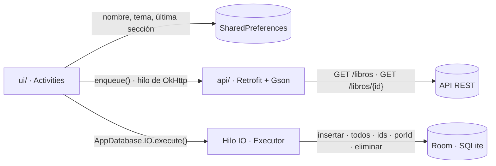

**Flujo integrado:**
1. Al abrir la app, `MainActivity` lee **SharedPreferences**: nombre, tema y última sección.
2. `ListaActivity` consulta el catálogo remoto con **Retrofit**.
3. El usuario guarda libros en **Room**, desde el corazón de la lista o desde el detalle.
4. La sección de favoritos y su detalle leen **Room**, así que funcionan sin Internet.

### Pantallas

| Pantalla | Clase | Fuente de datos |
|---|---|---|
| 1. Bienvenida y configuración | `MainActivity` | SharedPreferences + conteo en Room |
| 2. Catálogo | `ListaActivity` (`favoritos = false`) | Retrofit, con los favoritos marcados desde Room |
| 3. Detalle del libro | `DetalleActivity` | Retrofit; si no hay red, la copia guardada en Room |
| 4. Favoritos (offline) | `ListaActivity` (`favoritos = true`) | Room |

---

## 2. Clases principales

### `models/LibroEntity`
Un mismo modelo sirve para el JSON de la API y para la tabla de Room.
- Anotada con `@Entity(tableName = "favoritos")`; el campo `id` es `@PrimaryKey`.
- Campos: `id`, `titulo`, `autor`, `editorial`, `paginas` y `disponible`, que son los que pide el catálogo como mínimo.

### `api/LibroApi`
Interfaz de Retrofit que trae su propia instancia (`LibroApi.INSTANCE`).
- `@GET("libros") Call<Catalogo> catalogo()`: el catálogo completo. La API responde en formato HATEOAS (`{"_embedded":{"libroDtoList":[…]}}`), así que la clase interna `Catalogo` desenvuelve esa lista.
- `@GET("libros/{id}") Call<LibroEntity> detalle(long id)`: el detalle de un libro.
- `GsonConverterFactory` convierte el JSON en objetos Java.
- El tiempo de lectura de OkHttp es de **60 s**. El servidor gratuito de Render tarda unos 40 s en despertar, y con los 10 s por defecto la primera petición fallaba.

### `db/LibroDao`
DAO de Room con las operaciones de favoritos:

| Método | Operación |
|---|---|
| `insertar(libro)` | `@Insert(onConflict = REPLACE)` |
| `todos()` | `SELECT * FROM favoritos ORDER BY titulo` |
| `ids()` | `SELECT id FROM favoritos` (para marcar corazones y contar) |
| `porId(id)` | `SELECT * FROM favoritos WHERE id = :id` (respaldo sin red) |
| `actualizar(libro)` | `@Update` (refresca la copia local cuando llega el detalle de la API) |
| `eliminar(libro)` | `@Delete` |

### `db/AppDatabase`
- Clase `@Database(entities = {LibroEntity.class}, version = 1)`. Crea la base `libros.db` una sola vez y la reutiliza en toda la app.
- Expone `AppDatabase.IO`, un `Executor` de un solo hilo. Todas las consultas a Room pasan por él para no bloquear la interfaz.

### `adapters/LibroAdapter`
Adaptador del `RecyclerView` que comparten el catálogo y los favoritos.
- Cada tarjeta muestra el título, el autor, el ID, la editorial, las páginas y un chip de disponibilidad.
- El botón de la tarjeta cambia según la pantalla: en el catálogo es el corazón (vacío o relleno, según `setMarcados`) y en favoritos es la papelera.

### `ui/MainActivity` — Pantalla 1
- Lee y escribe SharedPreferences (archivo `prefs`) con tres claves: `nombre`, `oscuro` y `ultima`.
- El nombre y el tema se editan en un panel inferior. El interruptor solo **previsualiza** el tema; el botón **Guardar** es lo que lo guarda con `apply()`.
- El tema se aplica con `AppCompatDelegate.setDefaultNightMode()` antes de dibujar la pantalla.
- La tarjeta "Continúa donde lo dejaste" abre la última sección visitada.
- También muestra cuántos favoritos hay guardados, contándolos en Room.

### `ui/ListaActivity` — Pantallas 2 y 4
- Al abrir guarda `ultima = "catalogo"` o `"favoritos"`.
- En el **catálogo** llama a `catalogo().enqueue()`, que corre en un hilo de OkHttp.
  - `onResponse` valida `isSuccessful() && body() != null`. Si no se cumple, muestra un Toast con el código HTTP.
  - `onFailure` muestra *"No se pudo conectar al servidor. Revisa tu conexión a Internet."* sin cerrar la app.
  - El botón ↻ repite la petición.
- En **favoritos** lee `dao.todos()` en el hilo IO, así que funciona en modo avión.
- `alternarFavorito()` inserta o elimina el libro en Room y recarga la vista.

### `ui/DetalleActivity` — Pantalla 3
- Pide `detalle(id)` a la API.
- Si el libro es favorito, actualiza su copia local con `dao.actualizar()`.
- Si la petición falla, recurre a `dao.porId()` y avisa con *"Sin conexión: mostrando la copia guardada"*.
- Muestra si el libro es favorito y permite agregarlo o quitarlo.

---

## 3. Requerimientos técnicos

| # | Requerimiento | Cómo se cumple |
|---|---|---|
| 1 | Java en Android Studio | Todo el código fuente está en Java |
| 2 | Retrofit + Gson | `LibroApi` con `GsonConverterFactory` |
| 3 | Room | `LibroEntity`, `LibroDao`, `AppDatabase` |
| 4 | SharedPreferences | `MainActivity` y `ListaActivity` (archivo `prefs`) |
| 5 | Red y datos fuera del hilo principal | Retrofit con `enqueue()`; Room con `AppDatabase.IO.execute()` y regreso a la UI con `runOnUiThread()` |
| 6 | Validación HTTP y errores de red | `isSuccessful()`, `body() != null`, mensaje para el 404 en el detalle y `onFailure` con Toast |
| 7 | Paquetes `models`, `api`, `db`, `adapters`, `ui` | Ver la sección 1 |
| 8 | Sin datos sensibles en SharedPreferences | Solo se guardan nombre, tema y última sección |

---

## 4. Video demostrativo

[](https://youtu.be/rDWQA7iB9J4)

▶ **https://youtu.be/rDWQA7iB9J4**

Pantalla dividida y narrada: a la izquierda, la navegación por la app; a la derecha, diagramas del flujo de datos (SharedPreferences → Retrofit → Room → favoritos offline) sincronizados con cada escena.

---

## 5. Evidencias

### SharedPreferences: las preferencias persisten al reiniciar

| Antes de reiniciar | Después de cerrar la app a la fuerza y reabrirla |
|---|---|
| 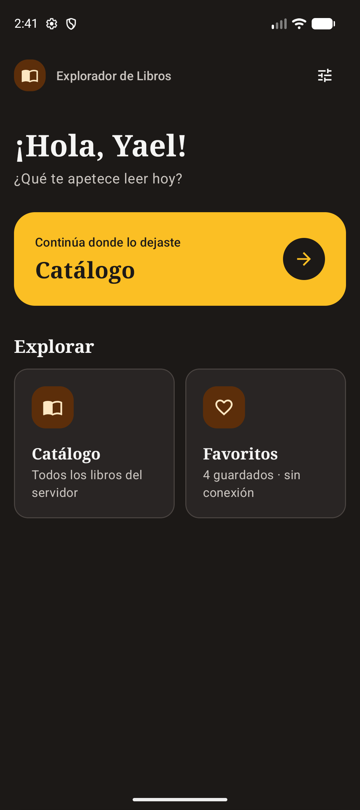 |  |

Contenido real de `shared_prefs/prefs.xml` en el dispositivo: [03_prefs_xml_en_dispositivo.txt](docs/evidencias/03_prefs_xml_en_dispositivo.txt)

| Guardar nombre y tema | Bienvenida personalizada | Recuerda la última sección |
|---|---|---|
| 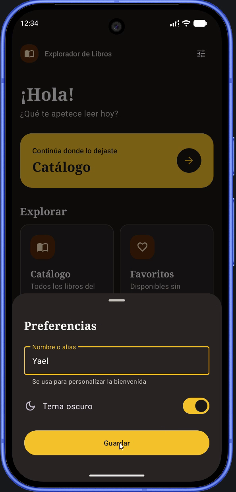 | 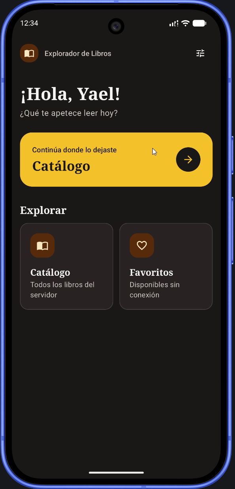 | 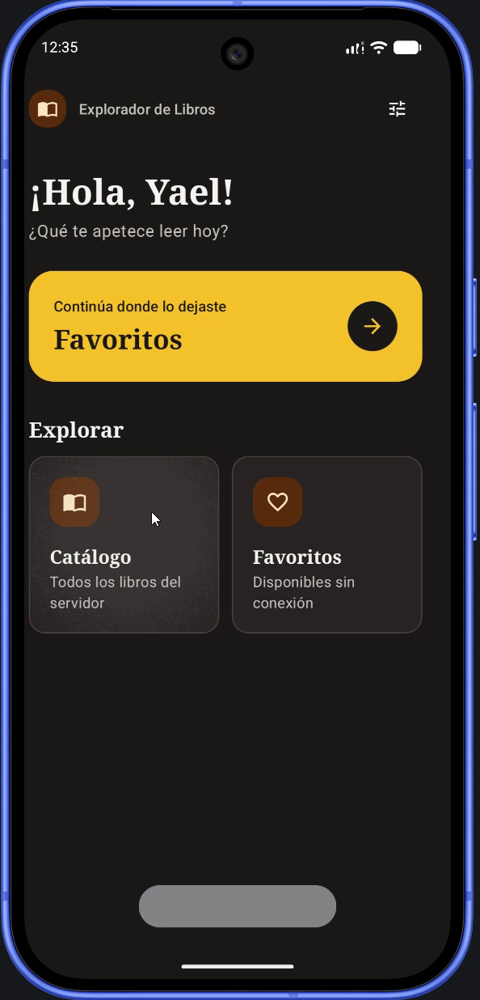 |

### Retrofit: catálogo remoto y manejo de errores

| Catálogo desde la API | Detalle del libro | Error sin conexión |
|---|---|---|
| 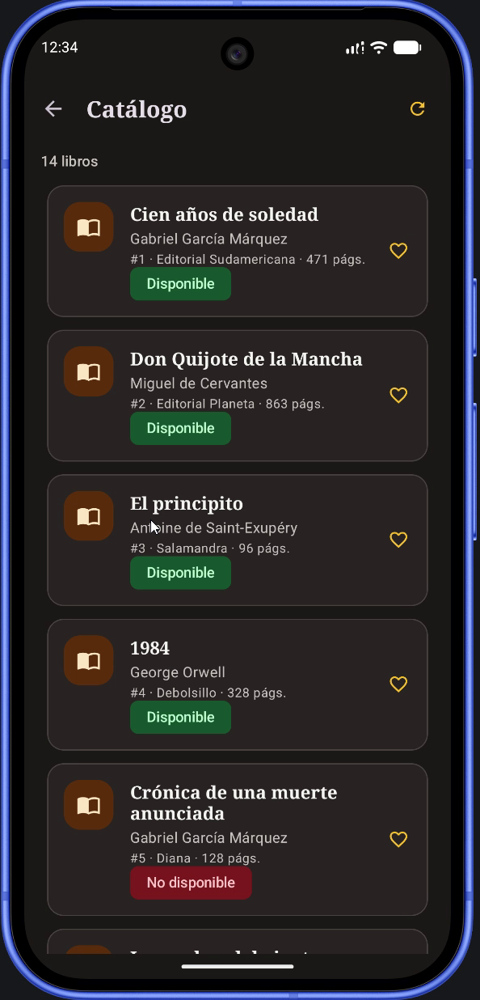 | 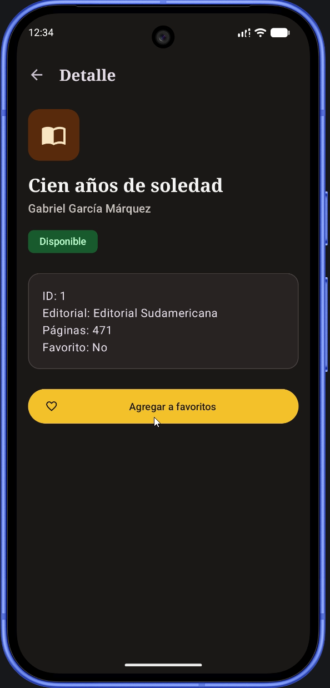 | 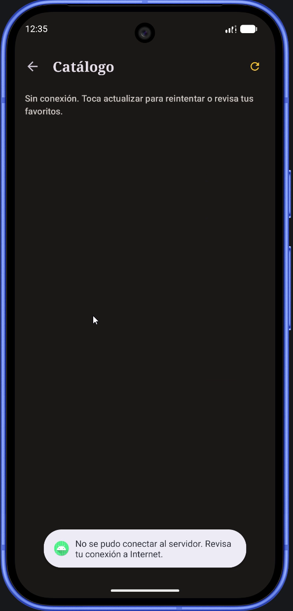 |

| Actualizando (↻) | Catálogo recargado |
|---|---|
| 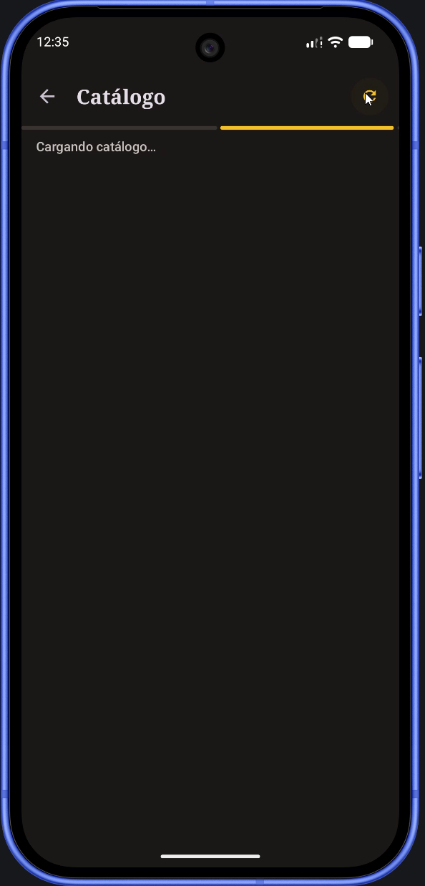 | 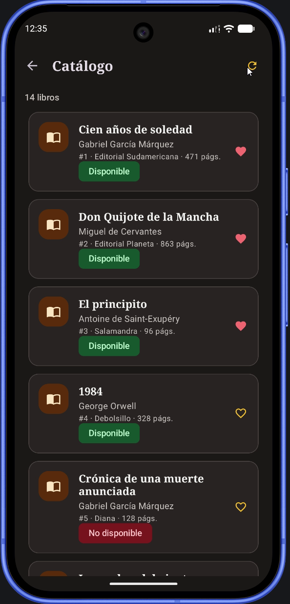 |

### Room: guardar y eliminar favoritos, y modo sin conexión

| Agregado a favoritos | Lista de favoritos | Favorito eliminado |
|---|---|---|
| 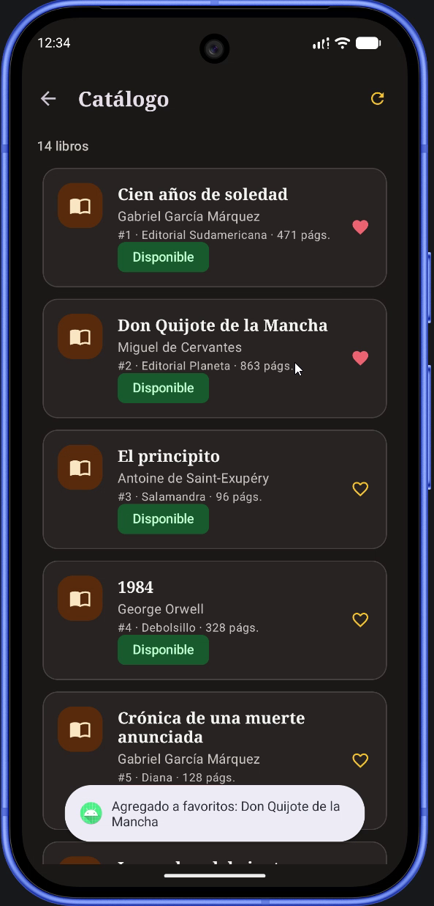 | 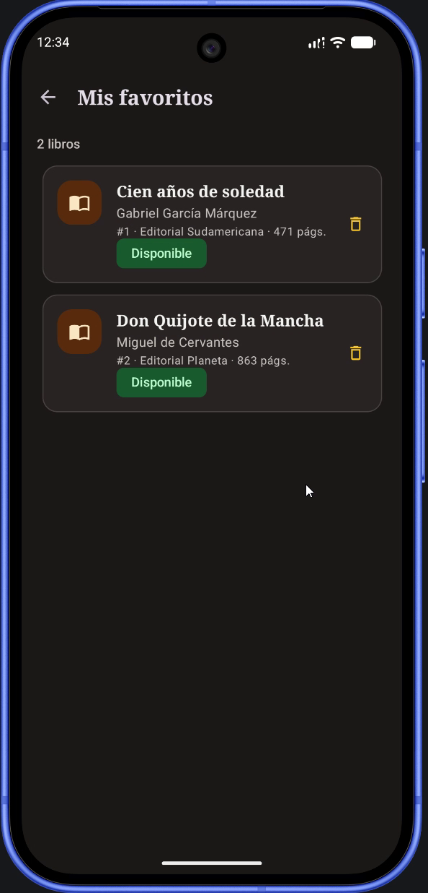 | 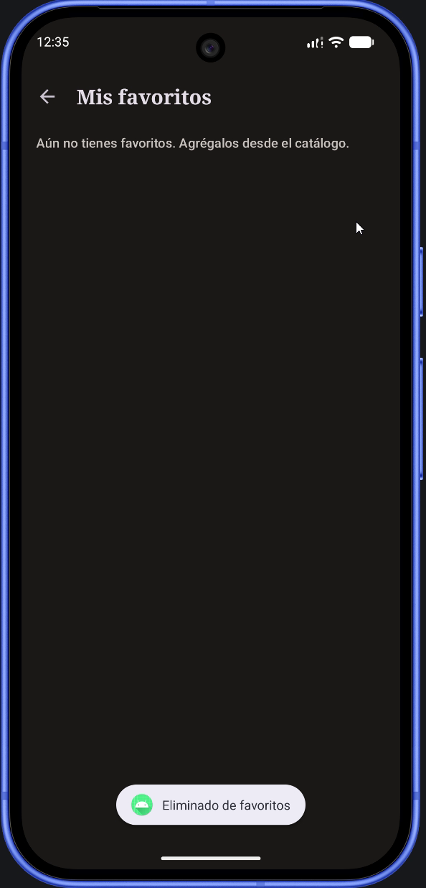 |

| Wi-Fi desactivado | Favoritos sin conexión | Detalle sin conexión (copia en Room) |
|---|---|---|
| 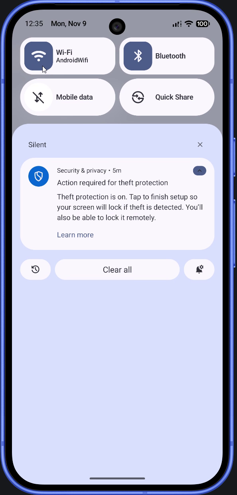 | 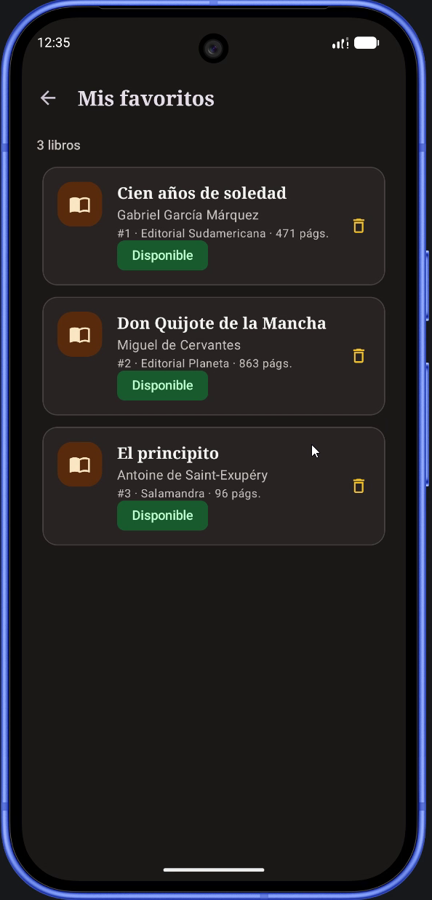 | 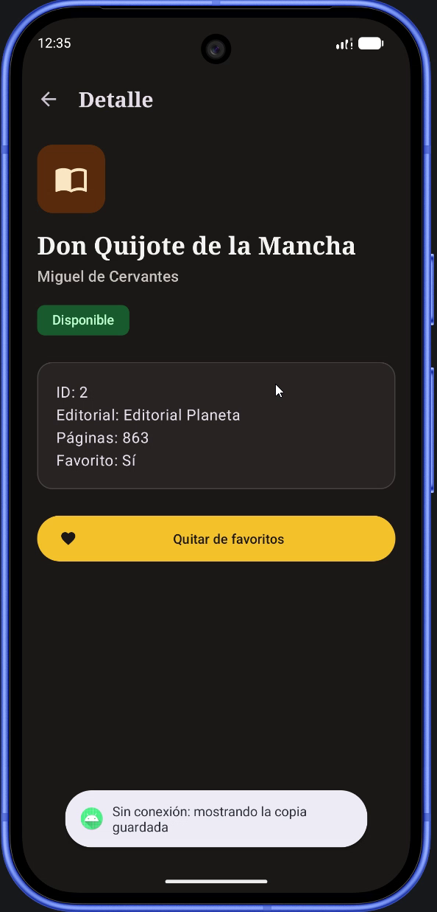 |
